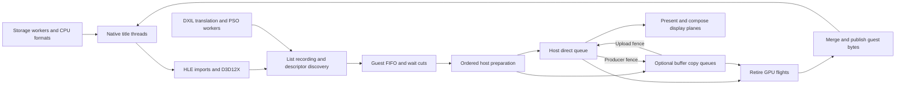
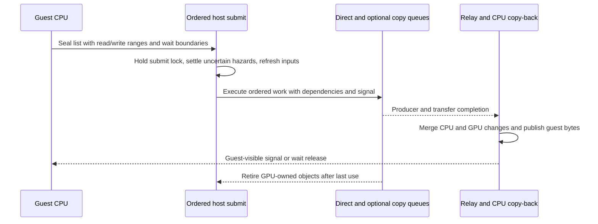
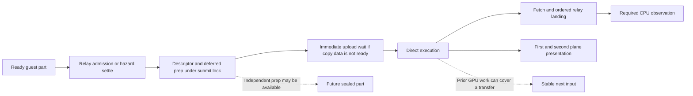
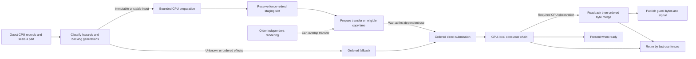
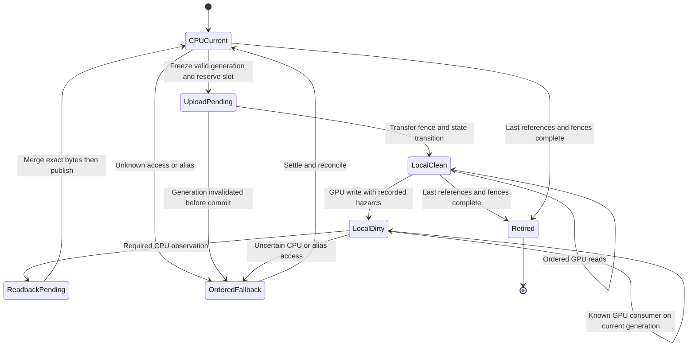

# UMA-aware software parallelism in VItoriaBr

## Executive summary

VItoriaBr can make more guest-produced data available at the right time and in the right memory domain on Windows. On a discrete adapter, guest address identity and guest-visible ordering can be maintained through host mirrors, barriers, and fences. The RAM–VRAM link, separate memory controllers, and hardware coherence properties remain those of the host.

At the [pinned upstream baseline][baseline] (`85615ad3d78b8efc9c42d34538f9099a6d3cb30a`), the runtime already pipelines several parts of submission and memory visibility. Relay stage 2, late-wait stage 3, and CPU-wide copy-back are the effective normal defaults for the unset configuration. Ordered async submission, async present, copy queues, and hardware-specific memory paths are selectable. Source inspection points to three next steps: measure and reduce broad synchronization of shadow ranges, keep data local across provably GPU-only consumers, and start existing bounded transfers earlier where traces show real overlap. The first deliverable for all three is an attributed trace with correctness checks.

## Scope and evidence

This is a static audit of Windows D3D12 execution and a plan for experiments. [Architecture](architecture.md) covers project structure, [performance architecture](performance-architecture.md) covers translation, PSO identity and submission, [comparative hypotheses](comparative-performance-hypotheses.md) compares related forks, and [shader warm-up](precompilacao-shaders.md) gives cache controls. This report follows the lifetime of guest bytes across those boundaries, including where the host can prepare work independently. It includes no gameplay measurements. Published results from different APIs or older repository revisions do not establish efficacy at this baseline.

| Evidence label | Meaning here |
| --- | --- |
| SOURCE-CONFIRMED | A reachable implementation, effective setting, guard, or data dependency verified at the linked commit. Runtime frequency still requires a trace. |
| REPOSITORY-REPORTED | A contributor report or repository comment with its own configuration and limits. |
| LITERATURE-SUPPORTED | A result or contract from a linked original paper, specification, or vendor technical document. |
| ARCHITECTURAL INFERENCE | A consequence inferred from source and the API contract, with assumptions stated. |
| UNVALIDATED HYPOTHESIS | A change and measurable prediction awaiting experiment. |
| EXPERIMENTALLY VALIDATED | A claim that survived a relevant, controlled VItoriaBr experiment and correctness gates. No optimization in this report has this status. |

### Upstream review

The baseline includes placed 3D UAV alias mirroring ([#72][pr72]), wide GPU hashing of card-copy pieces ([#33][pr33]), on-card CPU/GPU merge ([#37][pr37]), host warm-option overrides ([#24][pr24]), and the [second present plane change][baseline]. The review checked public pull requests, issues, history, and the repository's [asset policy](asset-policy.md). Pending contributions were considered separately from main. During review, upstream added [capped descriptor-heap capacity tuning][dynamic-slots]. It preserves the unset capacity and changes the number of slots available when configured. H8 measures allocation and preparation costs at fixed capacity and should record that control when tested on newer revisions.

| Contribution | Relation to this report |
| --- | --- |
| [#106][pr106], outside-buffer windows | Proposes 1 MiB grid and tails as defaults for already implemented controls. Reported private commit and resident window reductions across runs. Long-frame ranges overlap and one comparison reports increased copy bytes. H4 evaluates transferred gaps inside synchronization and treats window geometry as a separate factor. |
| [#107][pr107], on-demand mips | Proposes enabling an existing path by default on Tiled Resources Tier 2+. Reported VRAM savings are pending contributor evidence. H6 evaluates pressure interactions across resource classes and readmission, with mip policy held constant first. |
| [#90][pr90], Windows warm-up and BVH | Proposes host capability detection changes, pipeline-library write ordering/retry, wave fixes, and BVH residency work. Keep its PSO changes and correctness changes separate in any attribution. Main already includes warm overrides and the [#79][pr79] permute follow-up. |
| [#25][pr25], [#30][pr30], [#60][pr60] | Pending screen-pass workers, texture and storage scheduling, and a scaled texture-allocation floor. H7 targets work admitted across foreground and background pools. H10 targets bounded CPU-stage accounting and completion. H6 treats the allocation floor as a separate control. |
| [#63][pr63], fill synchronization, and [#66][pr66], storage handles | Relevant controls for semantics and I/O. A storage handle flag by itself does not create a bounded overlapped pipeline. |
| [#1][iss1], [#4][iss4], [#18][iss18] | Prior NVIDIA memory investigations, related-fork candidates, and an AMD regression report. Their commits, workloads, queue settings, and visual results differ. They motivate probes and matched-scene reproductions. |

## Literature and physical limits

The supplied desktop UMA review is a synthesis of four hypotheses, a topology comparison, diagrams and tables, and results drawn from papers, specifications, simulator reports and community sources. The analysis uses its topology, locality, fault overhead and bounded latency questions. Its cross-platform charts combine different devices, baselines and metrics. Link ceilings and local-memory bandwidth are distinct quantities, and a full software fault service event includes work beyond an individual memory access. The review provides no controlled test of this D3D12 runtime. The original sources below ground the mechanisms used in the proposal.

| Original source and evidence | Transfer to VItoriaBr |
| --- | --- |
| [Microsoft Xbox Series X and S specifications][xbox] and [PCI-SIG][pci] | Shared physical GDDR6 still has bandwidth regions. PCIe 4.0 and 5.0 x16 supply about 31.5 and 63.0 GB/s in one direction after line encoding and before transaction overhead. Record the actual negotiated width, rate and measured load. Software cannot import a console's memory controllers or hardware coherence. Shared physical memory, virtual address identity, and cache coherence are different properties. |
| Zheng et al., HPCA 2016, [Towards High Performance Paged Memory for GPUs][zheng] | Simulation of blocking migration, batching and overlap identifies control work and available latency hiding as separate factors. The simulated slowdown and idealized faults have no numeric predictive value for host shadows. |
| Allen and Ge, SC 2021, [In-Depth Analyses of Unified Virtual Memory System for GPU Accelerated Computing][allen] | Instrumented NVIDIA UVM on physical hardware. In the illustrated SGEMM trace, transfers account for less than a quarter of almost all fault-batch times. Measure syscall, scheduling, comparison and data movement separately in this project. The fraction is scoped to that trace. |
| Brokhman, Lifshits and Silberstein, USENIX ATC 2019, [GAIA: An OS Page Cache for Heterogeneous Systems][gaia] | Linux/Pascal prototype with page-cache access and lazy release consistency. Ownership alternation and false sharing motivate tracking overlapping backing ranges and explicit publish points. Native guest loads and D3D12 command lists have a different contract from GAIA release events. |
| Ganguly, Zhang, Yang and Melhem, ISCA 2019, [Interplay between Hardware Prefetcher and Page Eviction Policy in CPU-GPU Unified Virtual Memory][ganguly] | Physical GTX 1080 Ti characterization plus evaluated design alternatives. Neighborhood prefetch and pre-eviction interact under pressure. Pair prediction with an admission budget and measure eviction churn. Its oversubscription curves are not a Windows graphics forecast. |
| Pratheek B, Cox, Veselý and Basu, MICRO 2024, [SUV: Static Analysis Guided Unified Virtual Memory][suv] | CUDA compiler/runtime prototype uses access density, phased working sets and kernel-boundary prefetch. Recovered descriptors and measured reuse can guide conservative placement. Indirect guest addresses and incomplete shader metadata limit any static proof. |
| Shin, Bang, Park and Kim, HPCA 2026, [ARIADNE: Adaptive UVM Management for Efficient GPU Memory Oversubscription][ariadne] | IEEE proceedings abstract describes experimental changes to NVIDIA's UVM driver: pipelined fault service, a locality metric and adaptive migration versus remote mapping. The proceedings abstract and artifact record are public. Its driver implementation and workload speedups are outside scope. [Author artifact][ariadne-artifact] |
| [Linux HMM][hmm], [CUDA Unified Memory][cuda] and [CXL Consortium][cxl] | Useful boundaries for virtual sharing and hardware-coherent interconnects. Driver policy varies with platform and access pattern. Exclusive page migration describes some paths, while supported read duplication and remote mappings use different policies. CXL and offline simulation can model hardware effects, including coherence and contention, outside this Windows runtime experiment. [MGPUSim][mgpusim] |
| [D3D12 multi-engine synchronization][engines], [resource barriers][barriers], [residency][residency] and [fence-based lifetimes][rings] | Use queue signals and waits for dependencies, proper states/barriers for access, budgets for placement, and completion tokens for allocator, descriptor, upload and readback reuse. CPU mapping does not synchronize GPU writes. Independent queues can still contend for bandwidth or scheduling resources. |
| [Microsoft GPU Upload Heaps spec][gpu-upload], [AMD GPUOpen][amd-upload] and [NVIDIA upload guidance][nv-upload] | CPU-write/GPU-read staging can be placed in CPU-visible VRAM on supported hardware. CPU stores still cross PCIe on a discrete host. CPU reads and narrow or irregular writes can be costly. Vendor observations motivate a capability-gated crossover experiment. |
| [Xbox DirectStorage][xbox-storage], [Windows DirectStorage][pc-storage], [AMD pipeline walkthrough][amd-storage] and [NVIDIA GDeflate][nv-storage] | Xbox BCPack and fixed-function decompression have a different codec and execution contract from Windows GDeflate. Windows staging and GPU execution can add pressure. BypassIO is a conditional Windows 11 storage path. Vendor throughput and community frame-time claims need a same-workload test here. |

These results support explicit placement and batched asynchronous transfers for selected resource classes. For dense reuse, remote GPU reads can repeatedly pay link cost. For an immutable or streaming write-once buffer, a persistently mapped upload allocation or a GPU Upload Heap can avoid an extra staging operation under the right access pattern. Pinned guest memory, D3D12 mapping, ReBAR and GPU-local residency describe different capabilities. A consistently short critical path and low tail latency are the graphics goals, even where total throughput rises. If a fraction f of matched end-to-end latency can be accelerated by a factor s, Amdahl's bound for that change is 1 / ((1 - f) + f / s). Use exposed critical-path time for f and account for shared bandwidth and scheduling overhead. [Amdahl][amdahl] · [GPU Upload Heap contract][gpu-upload]

## Current execution and dependencies

**SOURCE-CONFIRMED.** The CLI mounts storage and binds the loaded image to HLE and the GPU host. The Windows loader invokes native x86-64 code on the title thread after DLL and TLS attachment. Native title threads enter HLE through the resolved imports, then record host work through logical queues and lists. Guest queue kind does not imply a dedicated physical engine. Shader and format code recover host representations, the pipeline crate supplies persistent cache mechanisms, and the host creates compatible D3D12 objects. The game crate supplies build and offline format discovery. [Run and mount][run] · [Loader entry][loader] · [Thread callbacks][threads] · [HLE resolution][hle] · [Guest queues][guest-queues] · [Direct queue][direct] · [Offline scan][offline] · [Formats][formats] · [Shader translation][translate] · [PSO construction][pipeline-host] · [Pipeline cache][pcache]

The source records list-local state under a mutex. A cut detaches command recording and the resources held by that part. The optional ordered submission worker consumes sealed work from the shared FIFO. Both submit modes converge on a `Host::submit` critical section under the submitted mutex. It spans relay admission, descriptor heap synchronization, write-watch batching, ordered copies/fills/callbacks, texture refresh, snapshot/card preparation and host submission. Deferred steps can observe intervening title writes. A callback with uncertain effects breaks a refresh batch. Resource retirement follows the relevant flight and releases held allocations, descriptors and allocators. [List state][list-state] · [Cut and detach][cut] · [Async worker][async] · [Shared release][release] · [Submit lock][submit] · [Deferred steps][steps] · [Allocator retirement][retire]

Some guest waits can use same-direct-queue ordering when a pending bottom-of-pipe write has a known satisfying value. Unknown values or overlapping shader writes can require a settle and CPU read. Guest fence signalling uses atomic ordering and wakes waiters. CPU-observable publication can include a merged snapshot and texture readback after the D3D12 fence. Present can drain held work or add a separate stage-3 flight. Guest wait handling, GPU barriers, hardware fences, CPU publication, and physical display timestamps are separately observable events. [Wait and force controls][waits] · [Bottom-of-pipe classification][bop] · [Guest fence][fence] · [Relay landing][landing] · [Present][present] · [Readback contract][readback]

**ARCHITECTURAL INFERENCE.** Blocking time on an edge is a measure of how long its consumer was held. The cost can originate in a GPU producer, CPU preparation, transfer, prior work, a mutex owner, or OS scheduling. A queue can report short API-call time while a GPU wait delays its first consumer. The critical chain varies across waits, streaming, PSO misses and steady rendering.

### Existing parallelism and memory mechanisms

| Control or mechanism | Effective behavior at the baseline |
| --- | --- |
| Relay and late waits | Unset relay selects stage 2. Late defaults to stage 3 via relay. Stage 1 overlaps flights with broad settling, stage 2 can merge CPU changes under in-flight writes, and stage 3 can admit an independent present flight. Per-list GPU timing disables the late path. Kept snapshots disable relay. The default cap on in-flight host lists is 256. Record effective choices and fallback reason per flight. [Relay defaults][relay] · [Late stages][late] · [Flight cap][flight-cap] |
| Wide copy-back | `VICTORY_WIDE_BACK` is on. A shared FIFO, mutex and condition variable feed bounded-width workers, the submit/copy-back caller may help, and dependent work joins the batch. Refresh also has an optional wide path and still joins. [Wide CPU workers][wide] · [Wide refresh][wide-refresh] |
| Async submit and present | `VICTORY_ASYNC_SUBMIT=1` is opt-in and requires late wait and cuts. Its worker still serializes release and host submit. `VICTORY_ASYNC_PRESENT=1` is an additional opt-in with stage 3, source and capture checks and a one-queued-present gate. At this commit the queued variant carries only plane one, while the direct present path can compose plane two. This is a source-level discrepancy. Keep the async present switch off in two-plane performance comparisons until rendering equivalence is demonstrated. [Worker][async] · [Async present gate][async-present] · [Queued present][queued-present] · [Multi-plane present][present] |
| `VICTORY_QUEUE2` | Off. Bit 1 is download and bit 2 upload. Separate transfer helpers use fences, a bounded GPU-local landing pool (96 MiB default for uploads) and direct fallback. Upload lands in an intermediate buffer before direct copies to the live target. Texture transfers use their existing path. [Switches and queues][queue2] · [Staging reuse][q2-lifetime] · [Fallback][q2-fallback] |
| GPU-local shadows and write tracking | Registered eligible card buffers default to a 1 MiB minimum and 1,024 MiB allocation cap. DXGI headroom and reserved room gate allocation. GPU-side changed-piece hashing and merging are active for eligible cases. CPU-side `COPY_CHANGED` refresh is opt-in. Write-watch and overlapping-view journals track page-granular changes. CPU copy-back has a three-way comparison path and pooled snapshots. [Card admission][card] · [Write watch][watch] · [CPU compare][changed] · [Snapshots][pool] · [Merge][merge] |
| In-place and upload heaps | `VICTORY_INPLACE` is off. Its eligible mappings pin guest pages and restrict remap/protection operations while shared. A separate outside-window GPU Upload Heap route is opt-in, gated by capability, allocation success, and a positive card-window cap. Ordinary upload heaps and guarded CPU copying remain available. These switches have different resource and synchronization semantics. [In-place][inplace] · [GPU Upload probe][upload-probe] · [Window tiers][window-upload] · [Guarded copies][plaincopy] |
| Textures | Descriptor-driven candidate priority and per-frame budgets already exist. Staging resources are pooled. CPU detiling/refresh runs on the preparation caller under per-image and remap protections, including when async submit moves that caller to a worker. The GPU work can run asynchronously. Tiled levels on demand require Tier 2+ and are opt-in at this revision. CPU texture copy-back is restricted to opted-in classes. [Draw admission][demand] · [Texture staging][texture-pool] · [Refresh][texture-refresh] · [Deferred execution][steps] · [Tiled enablement][tiles] · [Texture copy-back][texback] |
| Persistent caches and workers | Translated DXIL and native PSOs use separate keys and stores. The native library has per-key load synchronization, a guarded persist path and early-use history. Background PSO jobs run below normal at half logical cores, clamped to 2–8. Requested work outranks early work. The default shared pending-PSO wait allowance is 500 ms per title frame. Unavailable PSOs can already prevent work from being recorded, so reduced wait alone is an invalid speedup. [Shader cache][dxil-cache] · [Library][library] · [Pipeline wait][pso-wait] · [PSO workers][pso-workers] |
| Descriptor reuse and memory budgets | Per-list table reuse and a shared descriptor allocator already exist. Slots and captured resources are held for recorded use. DXGI local/nonlocal usage, admission budgets, texture heap reuse, age-based trimming and RAM pressure thresholds are already present, with separate accounting across features. [Table reuse][tables] · [Allocator][descriptor] · [DXGI counters][dxgi] · [Texture budget][budget] · [Texture trim][trim] · [Pressure][pressure] |

The unset tree permits speculative fill and source-only copy overlap in selected cases. Detection after landing can disable subsequent attempts. A later detection cannot restore a value an earlier consumer already read. Record it when characterizing the baseline, and hold `VICTORY_FILL_WAIT=1` on both sides of semantic performance comparisons. Keep texture no-wait diagnostics, artificial loop caps, timing modes that change queue behavior and coarse wait overrides out of equivalence claims. [Speculative fill][fill] · [Safety proposal][pr63] · [Texture no-wait][texture-wait]

## Optimization hypotheses

All proposed effects below are **UNVALIDATED HYPOTHESES**. Each starts from the source-confirmed path and makes a scoped architectural inference. Use the common benchmark and correctness protocol below for every comparison.

### H1 — Extract independent preparation from ordered submission

- **Baseline and gap.** The guest FIFO, cut lists and relay hazard rules already provide an ordered execution model. `Host::submit` serializes both stateful publication and independent preparation. Optional wide refresh joins under the submit path. Measure time with runnable work behind the lock separately from time blocked on an earlier guest dependency. [Submit][submit] · [Deferred steps][steps] · [Wide refresh][wide-refresh]
- **Experiment.** Build a small dependency graph for sealed parts. Start with pure CPU work on immutable inputs, such as decoding stable descriptor metadata or detiling an owned snapshot. Hand off bounded results by submission ticket, with a generation check before replay. Prioritize jobs by first dependent consumer. Apply backpressure on both bytes and queue age. Test work stealing only within proven independent jobs if measured imbalance remains. [Work stealing][stealing] · [Amdahl][amdahl]
- **Prediction and limits.** Shorter CPU-ready gaps and less lock hold time during mixed prep. Medium complexity for one class, high for a general graph. Vendor-neutral Windows path. Stale metadata, global remap or unknown guest reads require the existing ordered path. Count graph construction, steals, cache misses, stale result retries, lock hold, runnable preparation and idle GPU gaps. A/B in stable gameplay and transitions. Falsify if ready parallel work is scarce or net P99 and queue starvation fail to improve.

### H2 — Advance existing uploads and readbacks where dependencies permit

- **Baseline and gap.** Relay lands work in order. The optional copy upload lane is fed late in card preparation, then the direct queue waits and copies from the landing buffer. The download path waits on the direct producer and CPU visibility follows merge. In-flight fetching and batching already have controls. [Upload trigger][card-upload] · [Relay fetch][relay-fetch] · [Landing][landing] · [In-flight fetch][fetch]
- **Experiment.** A/B queue2 modes first. Then let a known, stable next input claim a fence-retired slot before its consumer reaches serial command preparation. Try two then three slots within byte/age caps. Enqueue the consumer wait only for that ticket. Preserve canonical target copies and retire slots after their actual last queue. Batch disjoint transfers if scheduling overhead dominates. Readbacks may move off the critical chain only with the publication guarantees in H3. Require proven independent resources and spare engine capacity before considering async compute. [Multi-engine][engines] · [Fence lifetimes][rings]
- **Prediction and limits.** Smaller direct idle gaps and steady-frame tails when prior direct work covers transfer. Moderate to high complexity. Queue and overlap availability vary by adapter and WDDM scheduling. Record CPU readiness, transfer enqueue/start/end, fences, direct idle, added copy bytes, staging occupancy and readback age. Compare memory-bound and render-bound phases, with and without pressure. Falsify if real overlap is absent, added copies erase the gain, backpressure worsens the tail, or guest observers receive a wrong version.

### H3 — Keep a proved GPU-owned generation local

- **Baseline and gap.** GPU-local shadows, on-card merge, alias views, and narrow texture copy-back already preserve some GPU locality. Raw-address access can declare a broad superset, and native CPU polling can bypass an HLE call. A texture twin is one representation of its backing bytes. The readback path carries tickets across replacement and remapping. [Raw addressing][raw] · [Card writes][card-writes] · [Alias views][alias] · [Texture copy-back][texback] · [Readback tickets][texback-tickets] · [Landing][landing]
- **Experiment.** First log producer, consumers and visibility by backing page or allocation, generation and alias family. Classify CPU-only, immutable, CPU-write/GPU-read, GPU-write/GPU-read, GPU-write/CPU-read, frequently modified, rarely used and transient ranges. Keep aliased/unknown a conservative override. Pilot one proved GPU-only producer–consumer chain, retaining a valid local generation across GPU reads. Materialize exact guest bytes before any CPU-visible edge, with eager fallback when addresses are indirect, partial proof cannot cover aliases, or a CPU access may be untrapped. [GAIA][gaia] · [SUV][suv] · [Barriers][barriers]
- **Prediction and limits.** Fewer round trips and less CPU copy-back on repeated GPU use. High semantic and validation cost, portable API. Track transfer and readback avoidance, dirty/valid state, alias invalidation and CPU visibility latency. Use GPU-only chains, CPU polling/atomics, overlapping placed resources, different-offset aliases and remap/retire/reuse tests before scene traces. Falsify on the first stale observation or if retained memory and metadata offset the gain under realistic pressure.

### H4 — Reduce synchronization amplification in existing shadows

- **Baseline and gap.** `Batch::add` can cover disjoint refreshes with a single span per shadow. `memory::ready` holds a global mutex and can refresh/declare all numbered raw-address shadows at first read/write in a list. Earlier snapshots track uncovered bytes but can reserve a full shadow. Journals, compare paths and pooled storage already exist. Raw-address miss notes help later discovery and do not establish a current memory observation. Producer-side write marking is prior work tracked in [#4][iss4]. [Coalescing][refresh-batch] · [Raw readiness][raw] · [Snapshot coverage][snapshot-cover] · [Refresh copies][refresh-copies]
- **Experiment.** Start with a capped disjoint span set and measured coalescing threshold in the existing batch. Preserve original write-watch boundaries and flush order. Measure the raw-address path independently, then consider trusted producer write footprints with a conservative fallback for uncertain bounds, overflowing metadata and incomplete shader reachability. A prior write set cannot bound future reads. [Allen and Ge][allen] · [Ganguly et al.][ganguly]
- **Prediction and limits.** Fewer compared/copied gap bytes and fewer CPU faults or memory stalls in sparse-write scenes. Low to moderate complexity for coalescing, high for proven producer tracking. No new adapter requirement. Record declared, requested, coalesced, compared, actually modified, copied in each direction, and redundant bytes per flight, plus snapshot capacity, faults, metadata/syscalls, lock hold and CPU visibility wait. Compare dense and sparse scenes and vary only the coalescer after fixing outside-window geometry. Falsify if fewer bytes produce no critical-path improvement, bookkeeping hurts the tail, or clipping drops any observable write.

### H5 — Bound prediction by first use and memory pressure

- **Baseline and gap.** The early PSO list already replays *interest* when the title recreates known pipeline objects. Shader caches, descriptor-driven texture preparation and catch-up budgets already provide look-ahead. The early list does not contain full replay inputs. Each interned shader also memoizes its translation. There is no established accuracy or useful lead-time distribution for a predictor at this baseline. [PSO demand and early admission][pso-wait] · [Library history and saves][library-save] · [Shader memoization][pipeline-shader] · [Texture admission][demand] · [Warm tool][warm]
- **Experiment.** Rank already-known requests by observed first-use distance, scoped to build, effective translation identity and compatible device/driver. Give newly demanded work capacity to bypass speculation. Apply byte/work/age caps, pressure cancellation, and generation checks. Consider texture prefetch only for stable contents and measured repeatable passes. Prefetching may prepare bytes or objects before demand while guest-dependent execution still waits. [SUV][suv] · [Ganguly et al.][ganguly] · [ARIADNE][ariadne]
- **Prediction and limits.** Fewer first-use waits in repetitive loads. Medium effort for PSOs and higher risk for textures. Track lead time, precision, coverage, nonconsumed work and bytes, evictions, missed demand, PSO queue age and first-correct-frame latency. Compare cold DXIL, warm DXIL and verified warm native PSOs independently, including fresh unpredictable scenes. Falsify if early hits do not repay speculative work or if demand stalls, memory pressure or correctness worsen.

### H6 — Coordinate memory pressure and re-admission across classes

- **Baseline and gap.** DXGI budget queries cover local and nonlocal groups. Separate thresholds and reserves govern shadows, textures, windows, temporary uploads and snapshots. Pressure-aware age sweeps already exist. Card-shadow eligibility is decided on allocation, and a periodic texture sweep can settle flights. Mip and window default changes are pending elsewhere. [Budget query][dxgi] · [Shadow admission][card] · [One-time choice][shadow-choice] · [Texture admission][budget] · [Reusable range allocation][ranges] · [Age sweep][trim] · [Submit sweep][sweep]
- **Experiment.** Record reservation, request, denial/reason, reuse distance and eviction-to-reload time across classes. Test pressure bands with hysteresis and a bounded replenishment rate against existing gates. Re-evaluate eligible refused objects only at valid retirement points. For a reconstructible clean texture, an idle-only sweep outside submission is a separate test. Protect irreplaceable GPU dirty data and in-flight aliased resources. [DXGI residency][residency] · [ARIADNE][ariadne]
- **Prediction and limits.** Fewer avoidable reuploads, denials and pressure stalls while keeping useful working sets. Medium-high integration and lifetime risk. Detect UMA/cache-coherent UMA and interpret shared segment usage accordingly. Compare stepped background VRAM pressure, low system RAM, idle recovery and revisited scenes. Measure local/nonlocal budget deltas, private commit, faults, missing resources and re-admission delay. Falsify if churn, nonlocal traffic or tail latency increases, or admission underutilizes available budget relative to the baseline.

### H7 — Protect latency-sensitive work from background CPU contention

- **Baseline and gap.** PSO workers already have priority bands and below-normal Windows priority. HLE storage has a reusable shared worker pool at logical-core count, three byte-weighted traffic classes and a staging allowance. `XAsync` may grow its pool to let mutually waiting callbacks progress. Audio has a separate XMA decoder thread and per-voice locks. Guest affinity widening and storage slow-core routing exist as controls. None of these individually accounts for concurrent PSO, shadow, title and I/O work. [PSO workers][pso-workers] · [Storage scheduler][disk-workers] · [XAsync][xasync] · [Audio][audio] · [Affinity][affinity]
- **Experiment.** On a measured contention trace, gate optional or early PSO/scratch work by queue age and active CPU budget, keeping foreground PSO requests and codec progress available. Profile load, menu and steady gameplay separately. Compare dedicated pools with shared limits before combining pools. Test topology and SMT policy on symmetric and hybrid hosts, leaving native guest scheduling alone in the first experiment. [WPA CPU analysis][wpa] · [Work stealing][stealing]
- **Prediction and limits.** Reduced CPU ready delay for submit and audio, improved frame tails during concurrent loading. Medium complexity. Priority inversion, PSO starvation and loader deadlock are possible regressions. Measure runnable/ready time, worker context switches, LLC and bandwidth pressure where available, demand/early PSO age, XMA ring minimum and WASAPI glitches. Falsify if the GPU was waiting on another cause, end-to-end tails or audio worsen, or frames omit previously executed work.

### H8 — Reduce contention in descriptor and command preparation

- **Baseline and gap.** Recording already uses list-local state. Table-content caching, a bindless range cache, and a circular dynamic arena avoid some work. Table hits still revisit hazards. Arena lock/search, descriptor discovery and repeated lookups are candidates once measured. Retirement returns ranges and can interact with replay shortcuts. [Local list state][list-state] · [Table cache][tables] · [Bindless ranges][bindless] · [Descriptor arena][descriptor] · [Retire and replay][retire]
- **Experiment.** Instrument lock wait separately from contiguous search time and live slot lifetimes. Trial per-list bulk leases or temporary allocation for proven-independent metadata with ordered installation; split only command preparation whose hazards and allocator ownership can be proved. Bound unused lease capacity. Validate dynamic indexing, clamp/null behavior, reset/replay paths, transitions, alias barriers and reuse only after relevant queues retire. [D3D12 barriers][barriers] · [Fence lifetimes][rings]
- **Prediction and limits.** Shorter record/prepare tails under descriptor pressure. Medium complexity, vendor-neutral within adapter heap limits. Compare contention-heavy and small-list scenes, synthetic near-capacity/replay cases, table hit rate, search steps, slot lifetime and fragmentation. Falsify on increased allocation failure, changed draw coverage or no critical-path reduction.

### H9 — Select transfer paths by access pattern and device capabilities

- **Baseline and gap.** The host already probes `OPTIONS16.GPUUploadHeapSupported` and tests a small allocation using a CPU write/read check. The optional window path further requires a positive GPU-local window allowance. Standard mapped `UPLOAD`, shared mapped memory, GPU-local defaults and pinned in-place mappings serve different purposes. The initial GPU Upload probe does not establish rendering correctness or speed. [Capability probe][upload-probe] · [Heap paths][heap-paths] · [Window choice][window-upload] · [In-place][inplace]
- **Experiment.** Cross size, cadence and reuse for sequential CPU-written, GPU-read buffers. Compare existing upload/default-copy, direct GPU access to mapped system memory where valid, and GPU Upload Heap paths when usable. Use bounded mapped slots retired by fences. Keep GPU-written data or CPU readback out of the CPU-write-only pilot. On discrete cards test actual ReBAR and compatible OS/runtime/driver, D3D12 capability, allocations, mapping and validation. The documented retail introduction was Agility SDK 1.613 on Windows 11 build 26080 or later. The device query and functional checks remain decisive. On integrated adapters query architecture and interpret locality accordingly. Keep ordinary staging as fallback. [Retail Agility support][upload-retail] · [Microsoft specification][gpu-upload] · [AMD][amd-upload] · [NVIDIA][nv-upload]
- **Prediction and limits.** Reduced copy queue work for certain producer patterns, with a crossover against CPU write-combining and local budget cost. Medium complexity and capability-dependent portability. Measure application-visible latency, CPU write time, engine time and local budget on NVIDIA and AMD and, where supported, an integrated adapter. Falsify if PCIe stores, CPU address costs or reduced available VRAM outweigh savings. General-purpose zero-copy for hot GPU reads is excluded from the candidate design.

### H10 — Decouple asset ingest and conversion with bounded completion

- **Baseline and gap.** The console DirectStorage facade runs positional synchronous reads on parallel workers, CPU zlib/BCPack, and writes guest VA/physical aliases before ordered completion. Some uncompressed address requests use a temporary buffer outside current staging accounting. Generic file HLE has guarded writes, and CPU texture refresh can run under the submit lock. The offline game-format scan is separate. [Storage read and decode][disk-execute] · [Staging accounting][disk-alloc] · [Publish and close][disk-completion] · [File HLE][files] · [BCPack][bcpack] · [Detiling][formats]
- **Experiment.** Account for bounce buffers first, then reuse bounded blocks and compare separated read completion and CPU decode pools with existing weighted priority. Keep destination ownership, aliases, first error in queue order, short-read behavior and close/cancel lifetimes. Compare a separate CPU texture worker only for owned snapshots with generation revalidation. [#30][pr30] already proposes scheduling and GPU detile changes. [#66][pr66] changes an open flag, while the pinned Rust positional-read wrapper is synchronous. True overlapped I/O requires a completion-safe API with request-owned state. [Rust read][rust-read] · [Windows IOCP][iocp]
- **Prediction and limits.** Lower asset-ready tails or less critical submit work without excess commit. High integration and test burden. The console BCPack stream is distinct from PC GDeflate or the newer PC Zstandard preview. Only test PC DirectStorage after a compatible source and destination are established, or a supported custom CPU route is justified. On Windows 11, BypassIO depends on NVMe and the storage stack. For GPU GDeflate, verify D3D12/SM6 and a supported destination and driver path, then test on a busy GPU against CPU decode. [Xbox contract][xbox-storage] · [PC DirectStorage][pc-storage] · [PC preview][storage-preview] · [BypassIO][bypass]
- **Falsification.** Compare original bytes/status/lifetime under single and mixed priorities, short/error paths and close during read. Measure read/decode queue age, page waits, raw and decoded bytes, owned scratch, texture refresh/first correct use and frame/audio tails. Reject if the first correct asset or frame arrives no sooner, GPU contention shifts cost into rendering, or any guest-visible behavior changes.

## Proposed execution and ownership model

Keep ordered guest-visible submission and publication. Make the inputs to those stages more selective, stable and available earlier. Phase 0 traces identify where the design can pay for its metadata.

Use identity that survives multiple views of the same backing with generation changes on writes, remaps and reuse. Track read/write access, pending fences and CPU validity separately. A CPU publication ticket follows transfer completion, an ordered merge and any required alias notification. Unknown callbacks, dynamic addresses, and untrapped reads retain conservative behavior. Caps apply to outstanding bytes, slots and age. Once a queue is full, throttle optional producers or use the ordered path. Never wait for a job while holding a lock that job needs.

Removing an unnecessary transfer, comparison or lock acquisition eliminates work. Starting an unavoidable transfer earlier can hide service time if useful independent work overlaps it, at the cost of more live state. Steady throughput for independent stages is limited by the slowest stage and shared resources. End-to-end observation latency follows the longest dependency chain plus queueing. Deeper buffers can improve throughput while increasing queue age, private commit and input-to-display delay. A full PCIe link, CPU memory saturation or render-bound execution can erase the benefit. D3D12 resource barriers, queue fences and guest CPU atomics impose distinct requirements.

### Correctness gates

- Preserve guest FIFO/wait/signal semantics, bottom-of-pipe ordering, atomics, CPU polling, visibility across aliases and remaps, and first-error order for I/O. Test known and unknown waits, overlapping CPU/GPU writes, read-after-write, write-after-read, write-after-write and partial subresources.
- Exercise descriptor updates, nulls and dynamic tables, command-list reset/reuse, resource destruction/replacement, present planes and resize. Check checked builds with the debug layer, GPU-based validation where available, and DRED or equivalent on failures. Any added TDR/device removal is a regression.
- Require matching pass/draw/dispatch coverage, including one-shot producers, and reviewed images at matched scene states. Use exact byte checks for deterministic resources and define tolerances before comparing nondeterministic output. Faster frames with omitted work, stale bytes, lower quality, altered shader math, disabled required barriers, or changed game logic fail.
- Record existing baseline quirks and failures separately. Check `VICTORY_FILL_WAIT=1` semantics before timing changes, verify forced waits never conceal observations on the route, and verify two-plane equivalence before testing async present. If an experiment changes correctness, report it separately from the performance comparison. [Baseline wait policy][waits] · [Fill overlap][fill] · [DRED][dred]

## Reproducible benchmark protocol

1. Build baseline and candidate from pinned source in the same release profile with identical Rust toolchain, dependency lock, features and instrumentation. Keep the uninstrumented release build for headline timing and use matched diagnostic builds for attribution. Record OS and build, WDDM/driver, adapter and wave width, GPU memory architecture and budgets, ReBAR capability, PCIe width/rate, CPU topology and affinity, RAM, storage type, display settings, and effective switch values and path fallback counts.
2. Use lawfully supplied local data, identical title build and capture settings, a repeatable save/state and input route, and event-based scene boundaries rather than time since launch. Keep resolution, quality, display mode, frame cap, CPU/GPU power mode and active tools constant. Keep title cache, OS file-cache state, PSO-library compatibility and driver cache state separate. Use separate experimental cache directories and label cold and warm states by observed counters. Keep private traces and game-derived output local.
3. Run all scenarios below on an unchanged control first, including repeated A/A runs. Randomize or alternate paired A/B runs and repeat across sessions. Start with at least five pairs per scenario, increase where noise obscures a prespecified practical effect, and keep scene coverage fixed. Report per-run summaries and paired uncertainty. For tails, use intervals by session or contiguous block. Show counts of valid frames and tail samples and qualify P99.9/0.1% low when coverage is insufficient. Record crashes, incomplete runs and truncations.
4. Establish the representative constrained Windows lane (Core i3-13100F, RTX 2060 SUPER 8 GB, 16 GB DDR4, NVMe), discrete AMD and NVIDIA lanes with different VRAM budgets and link widths, a larger or hybrid CPU, and a supported integrated lane for capability/fallback comparisons. Record unsupported lanes. The constrained lane hardware was available for inspection. No lawful, repeatable title run was established for this study. Synthetic cases can prove narrow invariants or calibrate probes. Gameplay claims require matched real gameplay.
5. Compare each mechanism in isolation first. Once measurements establish causal attribution, repeat a small interaction matrix. Preserve the same semantic controls on both sides. Report positive, neutral, negative and untested cases. Predeclare a material change above A/A noise and unacceptable ceilings for visible frame latency, memory pressure, audio and failures.

| Scenario | Control and comparison |
| --- | --- |
| Cold translation and cold native PSOs | Use fresh dedicated cache state. Observe translation misses, PSO makes, time to first correct frame, demand age and missing producers. |
| Warm DXIL and cold native PSOs | Reuse verified translation entries with same effective capability fingerprint. Keep native library cold. |
| Verified warm native PSOs | Verify library acceptance and meaningful loaded counts, with translated inputs and adapter/driver identity fixed. Keep RenderDoc out of cache-state verification. |
| Stable gameplay | Begin after compilation pressure subsides, with matching visible scene coverage, settled caches and fixed graphics options. |
| Scene transitions and heavy streaming | Repeat the same entry, path and return route. Track storage, decode, texture readiness, residency churn and the first correct asset/scene. |
| VRAM and system RAM pressure | Use reproducible stepped pressure levels per segment, record actual budgets/commit and compare near-cap, low-pressure and recovery states at fixed scene points. |
| CPU worker saturation | Compare workload-matched runs with I/O, shadow and PSO activity concurrent, and a warm control with compile pressure subsided. Confirm runnable delays in ETW. |
| Submission paths | Compare relay disabled with late unset, then effective relay stages 1 and 2 and late 1/2/3 where supported. Toggle wide back separately. Compare async submit off/on at the same relay/late/cut state. Keep async present off by default, with a separately validated experiment. |
| Copy and memory controls | Test `QUEUE2=0/1/2/3` with otherwise identical behavior and record fallback by flight. Isolate card in-flight fetch, window geometry, levels-on-demand, texture no-wait exclusion, and upload heap experiments. |

Use frame sequence, guest queue, list/part, submission ticket, range generation, queue fence and frame/present IDs to join events. Sample hardware timestamps with calibrated domains. Identify overlapping intervals and reconstruct causal edges before attribution. Report frame production and actual displayed cadence separately, along with queue depths and drops.

| Measurement | Collection and interpretation |
| --- | --- |
| FPS and frame latency | FPS = valid presented frames / elapsed observation seconds. Report P50/P95/P99/P99.9 frame durations, plus 1% and 0.1% lows as 1000 divided by the mean durations in the respective slowest tails in milliseconds. Record whether events are produced or displayed. |
| CPU critical path | ETW/WPA per-thread running/ready time, waits and context switches. Correlate allocator, submit and remap lock waits/holds with owning work, storage completion, worker runnable depth, and PSO queue age/promotions. |
| GPU critical path | PIX timing and GPUView by direct, compute and copy queues/engines, with actual intervals, idle, cross-queue waits, busy fraction and first consumer lateness. Nsight Graphics GPU Trace and Radeon GPU Profiler explain vendor-specific bottlenecks when compatible. D3D12 fence wall time and copy-thread wait time are separate from GPU work durations. |
| Traffic and residency | Declared, compared, changed, redundant and transferred bytes across direction/path, indexed by class. Per-stage stack, syscall, transfer latency and throughput, staging/snapshot sizes, peak private commit and working set, per-segment DXGI usage/budget, and process versus snapshot-related faults. |
| Correctness and reliability | Debug layer, GPU-based validation and DRED, WDDM TDR/device removals, use-after-retire or early reuse, stale reads, visual/draw/pass regressions, and audio underruns and glitches. Match debug/validation runs separately from headline timings. |

Existing `framelog`, `copystat`, `profile` and deferred `cardmeter` provide starting points. Per-list timing can change queue behavior, stack sampling can suspend threads, and process faults alone do not attribute snapshots. Compare trace overhead against uninstrumented runs. [Frame counters][framelog] · [Copy counters][copystat] · [Stack sampler][profile] · [Deferred GPU timings][cardmeter] · [PIX][pix] · [GPUView][gpuview] · [WPA][wpa] · [Nsight][nsight] · [RGP][rgp]

## Prioritized roadmap

Rank combines directly observed source gaps, plausible effects on the critical chain and P99, semantic risk, portability and implementation/validation cost. Within a phase, advance only when the prior trace or correctness gate justifies the complexity.

| Rank | Candidate | Evidence and trade-off |
| --- | --- | --- |
| 1 | H4 capped range coalescing | Directly observed transfer amplification candidate. Portable and relatively reversible. Producer tracking is a later, higher-risk subcase. |
| 2 | H2 earlier bounded transfer staging | Existing queues expose a measurable first-consumer wait. Good overlap potential where traces show independent work. Device engines and fences raise validation effort. |
| 3 | H3 proved GPU-owned generation | Strong locality rationale and large correctness surface. Begin with observability, then prove a narrow class before changing publication. |
| 4 | H7 phase-aware optional CPU work | Existing independent pools make contention plausible on small hosts. Test starvation and audio first. |
| 5 | H6 shared pressure and re-admission | Existing adaptive pieces reduce the scope. Prioritize if budget traces show repeatable stalls, denial or churn. |
| 6 | H8 descriptor hot paths | Existing caches and allocator require proof of residual contention before leasing or parallel preparation. |
| 7 | H1 bounded preparation graph | Useful after stable independent jobs are identified. General scheduling adds ordering and metadata overhead. |
| 8 | H10 bounded asset stages | Begin with measured allocation accounting, then require compatible I/O semantics and codec proof. |
| 9 | H5 adaptive prediction | Recurring paths may benefit. Incorrect lead time can increase residency, CPU work and queue starvation. |
| 10 | H9 hardware path selection | Benefit depends on actual CPU writes, reuse and feature support. Existing mechanism enables a narrow crossover experiment. |

| Phase | Dependencies and acceptance | Rollback |
| --- | --- | --- |
| 0 — Instrument and characterize | Pin reference builds and establish semantic controls, A/A variance, representative scenes and route identity. Attribute critical edges, bytes, lifetimes and tail spikes with a bounded collection overhead. Accept when traces explain waits across CPU/device timelines and reproduce controls without lost work. | Disable added collection, compare externally captured timing with lightweight counters, and fix observer effects before selecting a candidate. |
| 1 — Low-risk parallelism | Start H4 coalescing after amplification is measured. Test H7 and H8 only where traces establish contention. Measure H10 scratch accounting and H3 generations without changing guest-visible timing. Accept a positive matched effect above A/A noise and no failed correctness gates. | Keep each change independently selectable and preserve existing coalescing, worker and descriptor policies as controls. |
| 2 — Architecture | Require stable generations and accurate last-use fences. Prototype H2 early bounded staging, H3 one proved class, H6 hysteresis and, if ready work is material, H1 one extractable CPU job class. Accept reproducible idle/traffic or P99 reduction without extra display lag, missing assets, growing commit or memory-visibility failures. | Fall back per resource or class to eager publication/direct transfer and drain new work before switching paths. |
| 3 — Experimental | Require predictable backlog and pressure budgets for H5. Test H9 device-specific strategies and H10 true overlapped I/O or compatible decompression only after baseline crossover and lifetime checks. Accept measured gains on a declared hardware/workload region with a validated fallback elsewhere. | Leave opt-in and disable on unsupported, pressured or regressing hosts. Restore existing codecs, queues, heap paths and policy without altering the guest asset contract. |

Whole-runtime work stealing, universal async compute, blanket CPU readback deferral and transparent fault-driven migration are deprioritized. Existing ordering predicates are incomplete for arbitrary native reads and indirect descriptors. The system already has asynchronous submission, parallel copy-back, GPU-local shadows, copy queues and dynamic budget controls. A new feature pitch for those mechanisms would repeat main. The remaining research is to identify where their dependencies, granularity and workload policy can improve correctness-preserving latency.

## Conclusion

VItoriaBr can approximate selected functional benefits of console UMA by avoiding redundant host copies and keeping known producer–consumer chains local. For unavoidable movement, modest bounded overlap can reduce idle time while fences and aliases preserve the same observations. The strongest immediate experiment measures range amplification and tests a bounded coalescer. Ordered local ownership and earlier transfer slots follow when traces identify safe edges. These changes depend on the actual host memory topology and require same-scene validation.

## Verified reference index

The linked primary papers and specifications above support the indicated claims. The GPU UVM papers describe simulated or experimental behavior under their own workload and device assumptions. The Windows API references define capabilities and ordering. Contributor reports and source-confirmed defaults are labeled separately in the upstream review and mechanism inventory.

- Peer-reviewed originals or official records: [Zheng et al.][zheng], [Allen and Ge][allen], [Brokhman et al.][gaia], [Ganguly et al.][ganguly], [SUV][suv], [ARIADNE][ariadne], [Amdahl][amdahl], [Blumofe and Leiserson][stealing].
- Hardware and API contracts: [Xbox][xbox], [PCI-SIG][pci], [HMM][hmm], [CUDA][cuda], [CXL][cxl], [D3D12 engines][engines], [barriers][barriers], [readback][readback], [DXGI residency][residency], [fence lifetime][rings], [GPU Upload Heaps][gpu-upload], [retail runtime][upload-retail], [Xbox DirectStorage][xbox-storage], [Windows DirectStorage][pc-storage], [BypassIO][bypass].
- Vendor engineering notes: [AMD upload][amd-upload], [NVIDIA upload][nv-upload], [AMD streaming][amd-storage], [NVIDIA GDeflate][nv-storage].

[affinity]: https://github.com/uiliannn/VItoriaBr/blob/85615ad3d78b8efc9c42d34538f9099a6d3cb30a/crates/victory-gpu/src/spread.rs#L170-L211
[alias]: https://github.com/uiliannn/VItoriaBr/blob/85615ad3d78b8efc9c42d34538f9099a6d3cb30a/crates/victory-gpu/src/texture.rs#L415-L530
[allen]: https://tallendev.github.io/assets/papers/sc21.pdf
[amd-storage]: https://gpuopen.com/download/GDC-2023-DirectStorage-optimizing-load-time-and-streaming.pdf
[amd-upload]: https://gpuopen.com/learn/using-d3d12-heap-type-gpu-upload/
[amdahl]: https://www.cs.cmu.edu/~18742/papers/Amdahl1967.pdf
[ariadne]: https://ieeexplore.ieee.org/abstract/document/11408564
[async]: https://github.com/uiliannn/VItoriaBr/blob/85615ad3d78b8efc9c42d34538f9099a6d3cb30a/crates/victory-gpu/src/queue.rs#L487-L535
[async-present]: https://github.com/uiliannn/VItoriaBr/blob/85615ad3d78b8efc9c42d34538f9099a6d3cb30a/crates/victory-gpu/src/queue.rs#L102-L174
[audio]: https://github.com/uiliannn/VItoriaBr/blob/85615ad3d78b8efc9c42d34538f9099a6d3cb30a/crates/victory-hle/src/modules/audio.rs#L495-L675
[barriers]: https://learn.microsoft.com/en-us/windows/win32/direct3d12/using-resource-barriers-to-synchronize-resource-states-in-direct3d-12
[baseline]: https://github.com/uiliannn/VItoriaBr/commit/85615ad3d78b8efc9c42d34538f9099a6d3cb30a
[bcpack]: https://github.com/uiliannn/VItoriaBr/blob/85615ad3d78b8efc9c42d34538f9099a6d3cb30a/crates/victory-formats/src/bcpack.rs#L258-L295
[bindless]: https://github.com/uiliannn/VItoriaBr/blob/85615ad3d78b8efc9c42d34538f9099a6d3cb30a/crates/victory-gpu/src/draw.rs#L1660-L1702
[bop]: https://github.com/uiliannn/VItoriaBr/blob/85615ad3d78b8efc9c42d34538f9099a6d3cb30a/crates/victory-gpu/src/host.rs#L3248-L3330
[budget]: https://github.com/uiliannn/VItoriaBr/blob/85615ad3d78b8efc9c42d34538f9099a6d3cb30a/crates/victory-gpu/src/resource.rs#L1433-L1466
[bypass]: https://learn.microsoft.com/en-us/windows-hardware/drivers/storage/bypassio
[card]: https://github.com/uiliannn/VItoriaBr/blob/85615ad3d78b8efc9c42d34538f9099a6d3cb30a/crates/victory-gpu/src/shadow.rs#L441-L605
[card-upload]: https://github.com/uiliannn/VItoriaBr/blob/85615ad3d78b8efc9c42d34538f9099a6d3cb30a/crates/victory-gpu/src/host.rs#L4566-L4612
[card-writes]: https://github.com/uiliannn/VItoriaBr/blob/85615ad3d78b8efc9c42d34538f9099a6d3cb30a/crates/victory-gpu/src/host.rs#L4432-L4491
[cardmeter]: https://github.com/uiliannn/VItoriaBr/blob/85615ad3d78b8efc9c42d34538f9099a6d3cb30a/crates/victory-gpu/src/cardmeter.rs#L1-L23
[changed]: https://github.com/uiliannn/VItoriaBr/blob/85615ad3d78b8efc9c42d34538f9099a6d3cb30a/crates/victory-gpu/src/shadow.rs#L2294-L2304
[copystat]: https://github.com/uiliannn/VItoriaBr/blob/85615ad3d78b8efc9c42d34538f9099a6d3cb30a/crates/victory-gpu/src/copystat.rs#L12-L135
[cuda]: https://docs.nvidia.com/cuda/cuda-programming-guide/04-special-topics/unified-memory.html
[cut]: https://github.com/uiliannn/VItoriaBr/blob/85615ad3d78b8efc9c42d34538f9099a6d3cb30a/crates/victory-gpu/src/list.rs#L306-L458
[cxl]: https://computeexpresslink.org/about-cxl/
[demand]: https://github.com/uiliannn/VItoriaBr/blob/85615ad3d78b8efc9c42d34538f9099a6d3cb30a/crates/victory-gpu/src/draw.rs#L1982-L2210
[descriptor]: https://github.com/uiliannn/VItoriaBr/blob/85615ad3d78b8efc9c42d34538f9099a6d3cb30a/crates/victory-gpu/src/descriptor/host.rs#L1113-L1169
[direct]: https://github.com/uiliannn/VItoriaBr/blob/85615ad3d78b8efc9c42d34538f9099a6d3cb30a/crates/victory-gpu/src/host.rs#L682-L706
[disk-alloc]: https://github.com/uiliannn/VItoriaBr/blob/85615ad3d78b8efc9c42d34538f9099a6d3cb30a/crates/victory-hle/src/modules/dstorage.rs#L692-L746
[disk-completion]: https://github.com/uiliannn/VItoriaBr/blob/85615ad3d78b8efc9c42d34538f9099a6d3cb30a/crates/victory-hle/src/modules/dstorage.rs#L1069-L1199
[disk-execute]: https://github.com/uiliannn/VItoriaBr/blob/85615ad3d78b8efc9c42d34538f9099a6d3cb30a/crates/victory-hle/src/modules/dstorage.rs#L907-L972
[disk-workers]: https://github.com/uiliannn/VItoriaBr/blob/85615ad3d78b8efc9c42d34538f9099a6d3cb30a/crates/victory-hle/src/modules/dstorage.rs#L399-L608
[dred]: https://learn.microsoft.com/en-us/windows/win32/direct3d12/use-dred
[dxgi]: https://github.com/uiliannn/VItoriaBr/blob/85615ad3d78b8efc9c42d34538f9099a6d3cb30a/crates/victory-gpu/src/host.rs#L8772-L8833
[dxil-cache]: https://github.com/uiliannn/VItoriaBr/blob/85615ad3d78b8efc9c42d34538f9099a6d3cb30a/crates/victory-gpu/src/shader_cache.rs#L40-L174
[engines]: https://learn.microsoft.com/en-us/windows/win32/direct3d12/user-mode-heap-synchronization
[fence]: https://github.com/uiliannn/VItoriaBr/blob/85615ad3d78b8efc9c42d34538f9099a6d3cb30a/crates/victory-gpu/src/fence.rs#L83-L141
[fetch]: https://github.com/uiliannn/VItoriaBr/blob/85615ad3d78b8efc9c42d34538f9099a6d3cb30a/crates/victory-gpu/src/host.rs#L1813-L1847
[files]: https://github.com/uiliannn/VItoriaBr/blob/85615ad3d78b8efc9c42d34538f9099a6d3cb30a/crates/victory-hle/src/modules/files.rs#L527-L571
[fill]: https://github.com/uiliannn/VItoriaBr/blob/85615ad3d78b8efc9c42d34538f9099a6d3cb30a/crates/victory-gpu/src/host.rs#L2783-L2869
[flight-cap]: https://github.com/uiliannn/VItoriaBr/blob/85615ad3d78b8efc9c42d34538f9099a6d3cb30a/crates/victory-gpu/src/host.rs#L2607-L2621
[formats]: https://github.com/uiliannn/VItoriaBr/blob/85615ad3d78b8efc9c42d34538f9099a6d3cb30a/crates/victory-formats/src/texture.rs#L651-L742
[framelog]: https://github.com/uiliannn/VItoriaBr/blob/85615ad3d78b8efc9c42d34538f9099a6d3cb30a/crates/victory-gpu/src/framelog.rs#L23-L104
[gaia]: https://www.usenix.org/conference/atc19/presentation/brokhman
[ganguly]: https://doi.org/10.1145/3307650.3322224
[gpu-upload]: https://microsoft.github.io/DirectX-Specs/d3d/D3D12GPUUploadHeaps.html
[gpuview]: https://learn.microsoft.com/en-us/windows-hardware/drivers/display/using-gpuview
[guest-queues]: https://github.com/uiliannn/VItoriaBr/blob/85615ad3d78b8efc9c42d34538f9099a6d3cb30a/crates/victory-gpu/src/queue.rs#L24-L60
[heap-paths]: https://github.com/uiliannn/VItoriaBr/blob/85615ad3d78b8efc9c42d34538f9099a6d3cb30a/crates/victory-gpu/src/host.rs#L8939-L8997
[hle]: https://github.com/uiliannn/VItoriaBr/blob/85615ad3d78b8efc9c42d34538f9099a6d3cb30a/crates/victory-hle/src/lib.rs#L46-L108
[hmm]: https://docs.kernel.org/mm/hmm.html
[inplace]: https://github.com/uiliannn/VItoriaBr/blob/85615ad3d78b8efc9c42d34538f9099a6d3cb30a/crates/victory-gpu/src/inplace.rs#L66-L188
[iocp]: https://learn.microsoft.com/en-us/windows/win32/fileio/i-o-completion-ports
[iss1]: https://github.com/uiliannn/VItoriaBr/issues/1
[iss18]: https://github.com/uiliannn/VItoriaBr/issues/18
[iss4]: https://github.com/uiliannn/VItoriaBr/issues/4
[landing]: https://github.com/uiliannn/VItoriaBr/blob/85615ad3d78b8efc9c42d34538f9099a6d3cb30a/crates/victory-gpu/src/host.rs#L5310-L5432
[late]: https://github.com/uiliannn/VItoriaBr/blob/85615ad3d78b8efc9c42d34538f9099a6d3cb30a/crates/victory-gpu/src/host.rs#L2227-L2339
[library]: https://github.com/uiliannn/VItoriaBr/blob/85615ad3d78b8efc9c42d34538f9099a6d3cb30a/crates/victory-gpu/src/pipeline/library.rs#L423-L533
[library-save]: https://github.com/uiliannn/VItoriaBr/blob/85615ad3d78b8efc9c42d34538f9099a6d3cb30a/crates/victory-gpu/src/pipeline/library.rs#L594-L665
[list-state]: https://github.com/uiliannn/VItoriaBr/blob/85615ad3d78b8efc9c42d34538f9099a6d3cb30a/crates/victory-gpu/src/list.rs#L98-L122
[loader]: https://github.com/uiliannn/VItoriaBr/blob/85615ad3d78b8efc9c42d34538f9099a6d3cb30a/crates/victory-loader/src/windows.rs#L384-L419
[merge]: https://github.com/uiliannn/VItoriaBr/blob/85615ad3d78b8efc9c42d34538f9099a6d3cb30a/crates/victory-gpu/src/shadow.rs#L3124-L3278
[nsight]: https://developer.nvidia.com/nsight-graphics-features
[nv-storage]: https://developer.nvidia.com/blog/accelerating-load-times-for-directx-games-and-apps-with-gdeflate-for-directstorage/
[nv-upload]: https://developer.nvidia.com/blog/optimizing-dx12-resource-uploads-to-the-gpu-using-gpu-upload-heaps/
[offline]: https://github.com/uiliannn/VItoriaBr/blob/85615ad3d78b8efc9c42d34538f9099a6d3cb30a/crates/victory-game/src/sgd5.rs#L29-L110
[pc-storage]: https://devblogs.microsoft.com/directx/directstorage-1-1-now-available/
[pcache]: https://github.com/uiliannn/VItoriaBr/blob/85615ad3d78b8efc9c42d34538f9099a6d3cb30a/crates/victory-pipeline/src/cache.rs#L12-L73
[pci]: https://pcisig.com/sites/default/files/files/PCI-SIG-Seamless_Transition_to_PCIe_5.0_in_System_Implementations_FINAL.pdf
[pix]: https://learn.microsoft.com/en-us/windows/pix/timing-captures/timing-captures-overview
[plaincopy]: https://github.com/uiliannn/VItoriaBr/blob/85615ad3d78b8efc9c42d34538f9099a6d3cb30a/crates/victory-gpu/src/plaincopy.rs#L1-L64
[pool]: https://github.com/uiliannn/VItoriaBr/blob/85615ad3d78b8efc9c42d34538f9099a6d3cb30a/crates/victory-gpu/src/shadow.rs#L1631-L1669
[pr106]: https://github.com/uiliannn/VItoriaBr/pull/106
[pr107]: https://github.com/uiliannn/VItoriaBr/pull/107
[pr24]: https://github.com/uiliannn/VItoriaBr/pull/24
[pr30]: https://github.com/uiliannn/VItoriaBr/pull/30
[pr33]: https://github.com/uiliannn/VItoriaBr/pull/33
[pr37]: https://github.com/uiliannn/VItoriaBr/pull/37
[pr63]: https://github.com/uiliannn/VItoriaBr/pull/63
[pr66]: https://github.com/uiliannn/VItoriaBr/pull/66
[pr72]: https://github.com/uiliannn/VItoriaBr/pull/72
[pr79]: https://github.com/uiliannn/VItoriaBr/pull/79
[pr90]: https://github.com/uiliannn/VItoriaBr/pull/90
[present]: https://github.com/uiliannn/VItoriaBr/blob/85615ad3d78b8efc9c42d34538f9099a6d3cb30a/crates/victory-gpu/src/queue.rs#L1307-L1438
[pressure]: https://github.com/uiliannn/VItoriaBr/blob/85615ad3d78b8efc9c42d34538f9099a6d3cb30a/crates/victory-gpu/src/host.rs#L123-L164
[profile]: https://github.com/uiliannn/VItoriaBr/blob/85615ad3d78b8efc9c42d34538f9099a6d3cb30a/crates/victory-gpu/src/profile.rs#L1-L35
[pso-wait]: https://github.com/uiliannn/VItoriaBr/blob/85615ad3d78b8efc9c42d34538f9099a6d3cb30a/crates/victory-gpu/src/pipeline/make.rs#L97-L214
[pso-workers]: https://github.com/uiliannn/VItoriaBr/blob/85615ad3d78b8efc9c42d34538f9099a6d3cb30a/crates/victory-gpu/src/pipeline/make.rs#L265-L355
[q2-fallback]: https://github.com/uiliannn/VItoriaBr/blob/85615ad3d78b8efc9c42d34538f9099a6d3cb30a/crates/victory-gpu/src/queue2.rs#L508-L539
[q2-lifetime]: https://github.com/uiliannn/VItoriaBr/blob/85615ad3d78b8efc9c42d34538f9099a6d3cb30a/crates/victory-gpu/src/queue2.rs#L333-L435
[queue2]: https://github.com/uiliannn/VItoriaBr/blob/85615ad3d78b8efc9c42d34538f9099a6d3cb30a/crates/victory-gpu/src/queue2.rs#L21-L101
[queued-present]: https://github.com/uiliannn/VItoriaBr/blob/85615ad3d78b8efc9c42d34538f9099a6d3cb30a/crates/victory-gpu/src/queue.rs#L894-L913
[raw]: https://github.com/uiliannn/VItoriaBr/blob/85615ad3d78b8efc9c42d34538f9099a6d3cb30a/crates/victory-gpu/src/memory.rs#L244-L320
[readback]: https://learn.microsoft.com/en-us/windows/win32/direct3d12/readback-data-using-heaps
[refresh-batch]: https://github.com/uiliannn/VItoriaBr/blob/85615ad3d78b8efc9c42d34538f9099a6d3cb30a/crates/victory-gpu/src/host.rs#L7640-L7754
[refresh-copies]: https://github.com/uiliannn/VItoriaBr/blob/85615ad3d78b8efc9c42d34538f9099a6d3cb30a/crates/victory-gpu/src/shadow.rs#L3803-L3898
[relay]: https://github.com/uiliannn/VItoriaBr/blob/85615ad3d78b8efc9c42d34538f9099a6d3cb30a/crates/victory-gpu/src/shadow.rs#L1139-L1147
[relay-fetch]: https://github.com/uiliannn/VItoriaBr/blob/85615ad3d78b8efc9c42d34538f9099a6d3cb30a/crates/victory-gpu/src/host.rs#L4946-L5025
[release]: https://github.com/uiliannn/VItoriaBr/blob/85615ad3d78b8efc9c42d34538f9099a6d3cb30a/crates/victory-gpu/src/queue.rs#L732-L790
[residency]: https://learn.microsoft.com/en-us/windows/win32/direct3d12/residency
[retire]: https://github.com/uiliannn/VItoriaBr/blob/85615ad3d78b8efc9c42d34538f9099a6d3cb30a/crates/victory-gpu/src/list.rs#L458-L498
[rgp]: https://gpuopen.com/rgp/
[rings]: https://learn.microsoft.com/en-us/windows/win32/direct3d12/fence-based-resource-management
[run]: https://github.com/uiliannn/VItoriaBr/blob/85615ad3d78b8efc9c42d34538f9099a6d3cb30a/apps/victory/src/run.rs#L64-L129
[rust-read]: https://github.com/rust-lang/rust/blob/1.98.1/library/std/src/sys/pal/windows/handle.rs#L224-L264
[shadow-choice]: https://github.com/uiliannn/VItoriaBr/blob/85615ad3d78b8efc9c42d34538f9099a6d3cb30a/crates/victory-gpu/src/shadow.rs#L4266-L4341
[snapshot-cover]: https://github.com/uiliannn/VItoriaBr/blob/85615ad3d78b8efc9c42d34538f9099a6d3cb30a/crates/victory-gpu/src/shadow.rs#L2998-L3114
[stealing]: https://doi.org/10.1145/324133.324234
[steps]: https://github.com/uiliannn/VItoriaBr/blob/85615ad3d78b8efc9c42d34538f9099a6d3cb30a/crates/victory-gpu/src/host.rs#L7511-L7588
[storage-preview]: https://devblogs.microsoft.com/directx/directstorage-1-4-release-adds-support-for-zstandard/
[submit]: https://github.com/uiliannn/VItoriaBr/blob/85615ad3d78b8efc9c42d34538f9099a6d3cb30a/crates/victory-gpu/src/host.rs#L5857-L6009
[suv]: https://guilhermecox.github.io/dw/pratheek-micro24.pdf
[sweep]: https://github.com/uiliannn/VItoriaBr/blob/85615ad3d78b8efc9c42d34538f9099a6d3cb30a/crates/victory-gpu/src/host.rs#L5887-L5900
[tables]: https://github.com/uiliannn/VItoriaBr/blob/85615ad3d78b8efc9c42d34538f9099a6d3cb30a/crates/victory-gpu/src/draw.rs#L2997-L3084
[texback]: https://github.com/uiliannn/VItoriaBr/blob/85615ad3d78b8efc9c42d34538f9099a6d3cb30a/crates/victory-gpu/src/texback.rs#L38-L112
[texture-pool]: https://github.com/uiliannn/VItoriaBr/blob/85615ad3d78b8efc9c42d34538f9099a6d3cb30a/crates/victory-gpu/src/texture.rs#L194-L305
[texture-refresh]: https://github.com/uiliannn/VItoriaBr/blob/85615ad3d78b8efc9c42d34538f9099a6d3cb30a/crates/victory-gpu/src/texture.rs#L1180-L1278
[texture-wait]: https://github.com/uiliannn/VItoriaBr/blob/85615ad3d78b8efc9c42d34538f9099a6d3cb30a/crates/victory-gpu/src/texture.rs#L533-L562
[threads]: https://github.com/uiliannn/VItoriaBr/blob/85615ad3d78b8efc9c42d34538f9099a6d3cb30a/crates/victory-loader/src/threads.rs#L238-L273
[tiles]: https://github.com/uiliannn/VItoriaBr/blob/85615ad3d78b8efc9c42d34538f9099a6d3cb30a/crates/victory-gpu/src/tiles.rs#L75-L120
[trim]: https://github.com/uiliannn/VItoriaBr/blob/85615ad3d78b8efc9c42d34538f9099a6d3cb30a/crates/victory-gpu/src/resource.rs#L1778-L1838
[upload-probe]: https://github.com/uiliannn/VItoriaBr/blob/85615ad3d78b8efc9c42d34538f9099a6d3cb30a/crates/victory-gpu/src/host.rs#L8855-L8938
[upload-retail]: https://devblogs.microsoft.com/directx/agility-sdk-1-613-0/
[waits]: https://github.com/uiliannn/VItoriaBr/blob/85615ad3d78b8efc9c42d34538f9099a6d3cb30a/crates/victory-gpu/src/queue.rs#L191-L245
[warm]: https://github.com/uiliannn/VItoriaBr/blob/85615ad3d78b8efc9c42d34538f9099a6d3cb30a/apps/victory/src/warm.rs#L21-L110
[watch]: https://github.com/uiliannn/VItoriaBr/blob/85615ad3d78b8efc9c42d34538f9099a6d3cb30a/crates/victory-gpu/src/watch.rs#L1-L34
[wide]: https://github.com/uiliannn/VItoriaBr/blob/85615ad3d78b8efc9c42d34538f9099a6d3cb30a/crates/victory-gpu/src/shadow.rs#L1797-L1888
[wide-refresh]: https://github.com/uiliannn/VItoriaBr/blob/85615ad3d78b8efc9c42d34538f9099a6d3cb30a/crates/victory-gpu/src/host.rs#L7597-L7636
[window-upload]: https://github.com/uiliannn/VItoriaBr/blob/85615ad3d78b8efc9c42d34538f9099a6d3cb30a/crates/victory-gpu/src/shadow.rs#L4510-L4564
[wpa]: https://learn.microsoft.com/en-us/windows-hardware/test/wpt/cpu-analysis
[xasync]: https://github.com/uiliannn/VItoriaBr/blob/85615ad3d78b8efc9c42d34538f9099a6d3cb30a/crates/victory-hle/src/modules/xasync.rs#L150-L226
[xbox]: https://news.xbox.com/en-us/wp-content/uploads/sites/2/2020/09/FACT-SHEET_Gen9-Hardware.pdf
[xbox-storage]: https://learn.microsoft.com/en-us/xbox/gdk/docs/features/console/storage/directstorage/directstorage-overview?view=gdk-2604
[zheng]: https://d1qx31qr3h6wln.cloudfront.net/publications/HPCA_2016_Paged_Memory.pdf
[ariadne-artifact]: https://zenodo.org/records/17852674
[dynamic-slots]: https://github.com/uiliannn/VItoriaBr/commit/e40fba449b48730a345b1ddb3de281d3fdbf12fe
[mgpusim]: https://doi.org/10.1145/3307650.3322230
[pipeline-host]: https://github.com/uiliannn/VItoriaBr/blob/85615ad3d78b8efc9c42d34538f9099a6d3cb30a/crates/victory-gpu/src/pipeline/host.rs#L387-L498
[pipeline-shader]: https://github.com/uiliannn/VItoriaBr/blob/85615ad3d78b8efc9c42d34538f9099a6d3cb30a/crates/victory-gpu/src/pipeline.rs#L163-L203
[pr25]: https://github.com/uiliannn/VItoriaBr/pull/25
[pr60]: https://github.com/uiliannn/VItoriaBr/pull/60
[ranges]: https://github.com/uiliannn/VItoriaBr/blob/85615ad3d78b8efc9c42d34538f9099a6d3cb30a/crates/victory-gpu/src/ranges.rs#L1-L65
[texback-tickets]: https://github.com/uiliannn/VItoriaBr/blob/85615ad3d78b8efc9c42d34538f9099a6d3cb30a/crates/victory-gpu/src/texback.rs#L210-L249
[translate]: https://github.com/uiliannn/VItoriaBr/blob/85615ad3d78b8efc9c42d34538f9099a6d3cb30a/crates/victory-shader/src/emit/mod.rs#L325-L400
